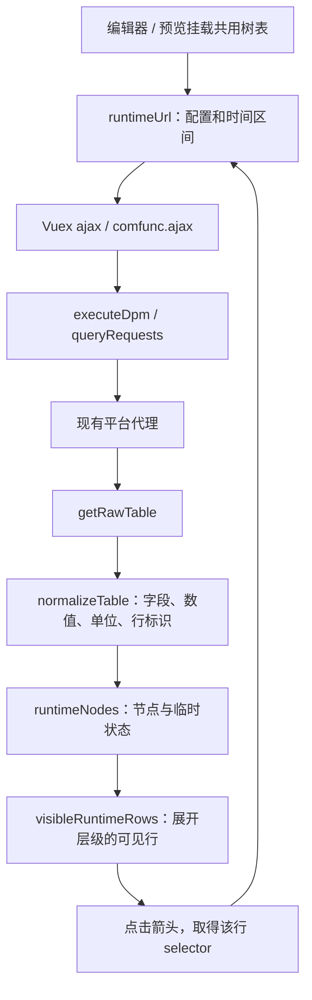

# 数据库运行统计树表开发设计

更新日期：2026-10-12。适用范围：NOP 大屏编辑器与预览中的数据库运行统计表。本文描述当前已实现的方案，作为后续开发、维护和验收入口；历史实施与修复记录见文末。

## 1. 业务语义与组件边界

运行统计按 SQL 语句、查询命令、返回码、实例、用户、客户端地址、应用等维度组织结果。顶层行是分析维度入口，下级行才是该维度内的具体条目及统计值。不同维度可能描述同一批访问，不能跨维度求总和、占比或混合排名。

采用按需查询的树表，支持数据库 `Database` 和数据库客户端 `DatabaseClient`。仅表格组件 `biaoge` 开放综合“运行统计”分析；其他图表保留该选项但置灰，并提示使用树表。实例、应用、命令等专门分析继续使用原有组件策略。

`isDpmRuntimeTable(item)` 是编辑器和预览的统一路由条件，必须同时满足：

- `item.type === 'biaoge'`。
- `item.config.datas` 为真且 `datastype === 'api'`。
- API URL 含数据库配置标记 `#nop-dpm-v1=`，且配置可读取。
- 配置的 `view === 'raw'`。

符合条件时挂载 `DatabaseRuntimeTable.vue`，否则走原普通表格渲染。不得让原平面表格刷新逻辑同时处理运行统计组件。

## 2. 界面与展示规则

表格由顶部工具栏、可选错误提示、固定名称列和五个数值列组成。编辑器工具栏提示“拖动移动 / 右键编辑 / 点击箭头展开”，预览仅提示“点击分类展开”；两端均提供刷新按钮。

| 列 | 字段 ID | 单位来源 |
| --- | --- | --- |
| 分析维度 / 条目 | `group.argument`，结合已知维度名称映射 | 无 |
| 平均最终响应时间 | `AVG_FINAL_RESP_TIME` | 响应列头归一化结果 |
| 平均首包响应时间 | `AVG_FIRST_RESP_TIME` | 响应列头归一化结果 |
| 查询速率 | `QUERY_COUNT_RATE` | 响应列头归一化结果 |
| 返回数据速率 | `BYTES_RETURNED_RATE` | 响应列头归一化结果 |
| 影响行数速率 | `ROWS_AFFECTED_RATE` | 响应列头归一化结果 |

默认列由 `RUNTIME_FIELDS` 唯一定义，用户无需选择指标。单位不能仅凭字段 ID 推断：例如响应时间列的毫秒在归一化层转换为秒，树表不再次换算；速率也不冒充总量。无结果时保持默认列名称，不编造单位。

名称列固定左侧，宽 260px；数值列最小宽 160px，右对齐，超宽可横向滚动。层级每增加一级缩进 16px。已知维度名称中文化，未知名称及具体子项保持返回文本；名称过长省略，并通过原生 `title` 查看完整文本。

顶层保持服务端返回顺序。下级兄弟条目按所选排序指标降序排列，缺失值置后；不能打散父子关系。同名条目通过各自 key 区分，不按显示名称合并。

缺失值显示“—”，有效零值显示 `0`。不补零、不合计平均值，也不额外改变精度。`canExpand` 为真时显示箭头；有效条件只表示允许尝试查询，不保证一定有子项。合法空子级显示“暂无下级记录”。

树表读取原组件的部分样式配置：`widgets.headerStyle.background`、`headerStyle.text.color/size` 和 `widgets.xStyle.color/fontSize`。表体透明，固定名称列采用深色背景。组件高度沿用 `item.style.height`，表体高度扣除工具栏及错误提示空间，并设置最小高度。原普通表格的所有高级样式配置不会自动完整继承。

## 3. 编辑数据配置

| 控件 | 配置 / 规则 |
| --- | --- |
| 数据源 | 沿用现有平台数据源选择及代理链路 |
| 分析对象 | `Database` 或 `DatabaseClient` |
| 分析内容 | `view: 'raw'`，显示“运行统计” |
| 数据库 / 客户端节点 | 必选 `selection`；可选候选或输入已知节点标识 |
| 查询时间 | 跟随页面 `dashboard` 或自定义区间 `fixed` |
| 展示列 | 默认六列说明，隐藏原指标多选控件 |
| 每组 Top N | `limit`，1 至 1000 的整数；用于请求下级条目，不能拿顶层维度数判断是否生效 |
| 排序指标 | `rawSortMetric`，五个默认数值字段之一；默认平均最终响应时间 |
| 包含 SQL 文本 | 可选 `rawSearch`，最长 200 字符，透传为接口 `search` |

节点候选是当前时间范围的 Top 活跃节点，初始数量 100，可加载更多至 1000；候选不是全部资产清单。查询对象或时间变化时清理旧候选并防止迟到响应覆盖新列表。

`runtimeConfiguration(query)` 在配置校验、API 生成及运行查询时统一设置 `view: 'raw'`、`widget: 'biaoge'`、`singleNode: false` 和默认五个 `metrics`，并删除临时 `rawSelection`。`singleNode: false` 用于允许返回多条树表行；运行统计仍因分析内容要求而必须选择节点。

## 4. 查询链路与接口契约



根查询与下级查询使用同一个 `getRawTable` 接口，通过现有平台代理请求；不新增浏览器直连数据源路径。树表接收 Vuex action 返回的归一化行数组，不直接处理原始 JSON。

| 请求参数 | 根查询 | 下级查询 |
| --- | --- | --- |
| `type` | `getRawTable` | 相同 |
| `start` / `end` | 有效区间，Unix 秒，`start < end` | 相同查询上下文 |
| `top` | `config.limit` | 相同 |
| `topMetric` | `RUNTIME_SORTS[rawSortMetric]` | 相同 |
| `visibleColumns` | 默认五个字段 ID，以逗号连接 | 相同 |
| `selection` | 所选节点的规范条件 | 当前行的完整服务端选择条件 |
| `search` | `rawSearch` 或空字符串 | 相同 |
| `preselect` | 空字符串 | 空字符串 |
| `json` | `true` | `true` |

排序 ID 与实际接口参数有独立映射，不应把字段 ID 直接作为 `topMetric`：

| 排序 ID | 服务端 `topMetric` |
| --- | --- |
| `AVG_FINAL_RESP_TIME` | `Average Response Time (Final Response) (sec)` |
| `AVG_FIRST_RESP_TIME` | `Average Response Time (First Response) (sec)` |
| `QUERY_COUNT_RATE` | `Transaction Rate (#/min)` |
| `BYTES_RETURNED_RATE` | `Rate of Kbytes Returned (kbytes/min)` |
| `ROWS_AFFECTED_RATE` | `Rate of Rows Affected (#/min)` |

根查询由 `selectionFor()` 处理节点标识：数据库使用 `DB_NODE_ID`，客户端使用 `CLIENT_NODE_ID`；已有完整节点条件不再重复添加前缀。

下钻则严格使用服务端返回的行标识。原始 JSON 的 `row.id` 经 `readTable()` 和 `normalizeTable()` 成为归一化行的 `selection`，再存为树节点的 `selector`。调用 `runtimeUrl(api, start, end, selector)` 时，将其作为临时 `rawSelection`，由查询生成器直接放入请求 `selection` 参数。只做 URL 传输所需的编码，不额外解码或补节点前缀，不能用显示名称、SQL 文本或本地拼接条件代替。

原始 JSON 应包含 `columnIds` 和 `rows`，行值在 `row.values` 中。非空结果缺少所需指标列、数值字段含非法内容、空响应文本或返回网页，均属于查询失败。结构合法且 `rows: []` 才是可展示的空结果。

## 5. 归一化数据与树节点模型

树表依赖的归一化行结构如下；示例名称与条件均为占位内容：

```js
{
  group: { label: '运行分组', argument: 'Query Command' },
  selection: '服务端返回的完整行条件',
  metricValues: [
    { metric: { id: 'AVG_FINAL_RESP_TIME' }, unit: '秒', value: 0.018 }
    // 其余四个默认数值字段按相同结构提供。
  ]
}
```

| 树节点字段 | 用途 |
| --- | --- |
| `key` | 父路径加本次响应行序号；用于渲染，不作为请求条件或永久行 ID |
| `label` | 中文化维度名称或具体返回名称 |
| `selector` | 完整服务端条件，仅供当前组件下钻 |
| `depth` | 层级缩进和下级排序判断 |
| `ancestors` | 祖先 selector 列表，防止沿同一路径循环下钻 |
| `values` | 五个字段 ID 对应的归一化数值，缺失为 `null` |
| `canExpand` | 条件非空，且不与当前祖先条件重复 |
| `expanded` | 是否展开 |
| `loading` | 当前节点是否正在查询 |
| `loaded` | 是否已成功查询；合法空结果也记为成功 |
| `error` | 当前节点查询错误 |
| `children` | 当前上下文内缓存的直接子节点 |

父节点通过 `children` 保留真实层级；`visibleRuntimeRows()` 按展开状态生成平面可见行数组交给 Element UI 表格。表格的 `tree-props` 指向未使用的字段名，防止 Element UI 再遍历 `children`，导致重复渲染或与自定义展开逻辑冲突。

## 6. 展开、刷新与异步状态

1. 初次挂载：`queryContext` 的立即 watcher 调用 `reload()`，请求顶层维度并设置列名称和单位。
2. 首次展开：切换 `expanded`，在尚未加载且没有请求进行时查询子级。加载中显示按钮 loading，避免重复请求。
3. 收起：隐藏该节点下级可见行，保留本次上下文的子级缓存。再次展开已加载节点不重复查询。
4. 子级失败：在该父节点下显示“加载失败”和重试入口，错误不应覆盖其他已加载分支。重试成功后更新缓存。
5. 手动或定时刷新：重新请求根数据；同一上下文中先保存展开的 selector 路径，再逐层重查并恢复仍存在的展开分支。刷新会重建数据，不继续使用旧数值。
6. 节点、数据源、查询配置或有效时间变化：清空旧树与缓存，不跨上下文恢复展开路径。

固定时间模式只使用 API 中保存的 `start/end`，页面时间变化不会触发重查；跟随页面模式将页面 `start/end` 纳入上下文并使用最新区间。上下文由 API 配置和必要的页面时间组成。

组件用 `generation`、`queryContext` 和销毁标记检查返回结果是否仍有效。每次重载递增 generation，销毁时也递增；旧请求完成后不再写入新树。当前实现是忽略过期结果，未取消底层 HTTP 请求。

编辑器和预览的 `reBiaoge()` 遇到运行统计时转给 `refreshDpmRuntimeTable()` 并提前返回。该函数从 `runtime-<组件 ID>` ref 找到组件；处于加载中或上下文尚未一致时不重复触发页面刷新。

## 7. 编辑器鼠标交互

展开与布局编辑共享同一张表格，必须根据命中目标区分行为：

| 操作位置 / 输入 | 当前行为 |
| --- | --- |
| 标题文字或标题空白，左键拖动 | 选中组件并移动 |
| 表体单元格，包括名称和数值，左键拖动 | 选中组件并移动 |
| 展开箭头、刷新、重试按钮 | 选中组件；按钮执行自身操作，不启动拖拽 |
| 表头及列宽调整区域 | 保留表格自身交互，不启动组件拖拽 |
| 表体滚动容器 / 滚动条 | 保留滚动，不启动组件拖拽 |
| 任意表格位置，右键 | 选中对应组件，打开原有置顶、置底、删除菜单 |
| 边缘八个缩放手柄 | 沿用组件缩放逻辑 |
| 多选组件 | 沿用原组选择遮罩及组移动逻辑 |

编辑器在树表根节点上绑定 `mousedown.native.stop`、`contextmenu.native.prevent.stop` 和 `click.native.stop`。`runtimeTableMouseDown()` 将按钮等控件排除在移动区域之外；移动区域为 `.runtime-toolbar` 与 `.el-table__body td`。右键不安装拖动监听，由 `runtimeTableContextMenu()` 显式调用原菜单入口。

`imgModulesMouseDown(event, id, interacting)` 先执行组件选中和配置面板更新；当 `interacting` 为真时提前返回，避免安装 document 拖动监听。按钮的 click 不能继续冒泡至画布取消选择逻辑。

单独选中运行统计时，`runtimeSelectionInteractive` 为真，`#zoom-container` 添加 `runtime-interactive-selection`：容器与 `#drop-board` 设置 `pointer-events: none`，内容接收点击；`.zoom-handler` 保持 `pointer-events: auto`，以便缩放。普通组件与多选时不启用该穿透规则。

删除仍使用已有确认框。当前 `moduleDelete()` 的行为是将所选组件 `style.display` 设为 `none`，并隐藏确认框和选择框，并非立即从组件数组移除。取消不隐藏组件。本表不另建删除或保存 API，布局与配置继续沿用大屏保存流程。

不能重新引入覆盖整个表体的可点击拖拽遮罩，也不能将整个树表统一视为可拖动区域，否则箭头、刷新与滚动会再次失效。仅调用 `toggle()` 等方法的测试无法证明真实编辑器中的按钮可点击。

## 8. 保存、兼容和数据边界

沿用组件已有 `config.api` 字段，在 URL fragment 中保存版本化数据库配置，不新增后端大屏结构。fragment 供前端恢复配置，不发送到数据源。固定时间区间保存在请求 URL 参数中；跟随页面时间在运行时替换。

持久配置包含对象、节点、分析内容、默认字段、时间模式、每组数量、排序和搜索条件。`readDpmUrl()` 使用已有迁移规则读取旧配置；进入运行统计查询时强制使用默认五列，编辑数据确定后保存统一配置。

展开状态、子级行数据、请求 loading/error 与下钻 `rawSelection` 仅保存在当前组件内存，不写入用户组件的 `widgetdata` 或原 `config.api`。临时请求 URL 可以携带下钻配置，但不能回写为持久 API。服务端行条件不可凭名称重新构建。

展示名称按纯文本渲染，不使用 `v-html`；归一化时移除受支持的展示标签，保留比较符号与转义后的文本。验收日志和开发文档使用占位条件，不保存 Cookie、密码、认证信息、SQL 正文或完整敏感选择条件。SQL 长文本仍可能通过名称提示显示，应沿用现有数据源权限。

## 9. 代码职责与维护入口

以下路径均相对前端项目根目录：

| 文件 | 职责 |
| --- | --- |
| [DatabaseRuntimeTable.vue](../src/components/DatabaseRuntimeTable.vue) | 共用渲染、展开状态、缓存、重载与异常展示 |
| [runtime.js](../src/dataSources/dpm/runtime.js) | 运行统计识别、默认配置、URL、列、树节点与刷新入口 |
| [catalog.js](../src/dataSources/dpm/catalog.js) | 默认字段、排序参数和维度分析配置 |
| [query.js](../src/dataSources/dpm/query.js) | 查询校验、参数生成、配置编码及读取 |
| [normalize.js](../src/dataSources/dpm/normalize.js) | 原始响应结构、字段、单位、数值和行标识归一化 |
| [execute.js](../src/dataSources/dpm/execute.js) | 查询执行与归一化衔接 |
| [comfunc.js](../src/apis/comfunc.js) | 共用 ajax 与现有平台代理请求 |
| [DatabaseFields.vue](../src/components/ApiModal/DatabaseFields.vue) | 节点、默认列说明、排序、数量、搜索控件 |
| [ApiModal.vue](../src/components/ApiModal.vue) | 编辑数据流程与持久 API 生成 |
| [capabilities.js](../src/dataSources/dpm/capabilities.js) | 运行统计只适配表格的统一限制 |
| [imgeditor.vue](../src/view/imgmodules/imgeditor.vue) | 挂载、选中、移动、缩放、菜单与刷新分发 |
| [preview.vue](../src/view/imgmodules/preview.vue) | 共用树表挂载与刷新分发 |
| [database-runtime-tree.spec.js](../test/unit/specs/database-runtime-tree.spec.js) | 数据契约、组件生命周期、配置和编辑器事件回归 |

增改默认字段时需同步核对字段目录、接口映射、配置校验、固定展示说明、单位与排序，并补充对应接口响应测试。修改鼠标交互时必须同时回归展开、拖动、菜单、缩放和滚动。

## 10. 验收要求与当前证据

| 验收层级 | 必查内容 | 当前证据 |
| --- | --- | --- |
| 数据契约 | 真实 selector 原样使用、缺少标识、祖先循环、默认列、零值与空值、比较符号 | 自动回归 |
| 组件生命周期 | 两级查询、收起缓存、空子级、失败重试、刷新恢复、固定 / 页面时间、迟到响应 | 自动回归；独立组件曾完成两类对象下钻实测 |
| 配置 | 旧配置重开、无需选指标、默认列、排序、搜索与每组数量生成 | 自动回归；已测命令分组 Top 2 |
| 真实编辑器 | 选中后的正常箭头点击、展开收起、刷新、单元格拖动、右键菜单、删除确认及取消 | 2026-10-12 浏览器验证 |
| 布局与隔离 | 标题 / 单元格移动、手柄缩放、多选组移动、控件不启动拖拽、删除确认隐藏 | 编辑器模板回归；真实页面验证单元格移动并恢复位置 |
| 构建 | 数据库及平台会话回归、相关文件 lint、生产配置隔离构建 | 最近一次 15 个测试文件、165 项通过；lint 和构建通过 |

在前端项目目录执行相关回归：

```powershell
node node_modules/jest/bin/jest.js --config test/unit/jest.conf.js --runInBand --silent --testPathPattern='(database-|platform-session-)'
node node_modules/eslint/bin/eslint.js src/components/DatabaseRuntimeTable.vue test/unit/specs/database-runtime-tree.spec.js
```

真实页面验收要通过正常鼠标操作，而非强制点击被覆盖的按钮或直接调用组件方法。至少覆盖“未选中时第一次展开”“已选中时展开”“菜单和展开同时可用”，并确认拖动验证后恢复原布局。确认删除可在测试数据中执行；现有用户大屏只验证打开确认框和取消。

最新证据：[自动回归](../../backups/runtime-table-edit-operations-20261012/unit-results.json)、[浏览器操作结果](../../backups/runtime-table-edit-operations-20261012/browser-results.json)、[生产构建结果](../../backups/runtime-table-edit-operations-20261012/production-build-result.json)、[右键菜单与展开截图](../../backups/runtime-table-edit-operations-20261012/runtime-context-menu.png)。这些证据属于已测范围，不能扩展为所有维度、时段及查询组合均已验收。

## 11. 当前边界与后续扩展

当前使用固定默认列，尚未实现显示列管理、专门的 SQL 详情面板、树表单元格阈值着色、展开路径持久化或任意深度的性能专项优化。运行统计没有接入普通表格的列宽保存回调，调整列宽不应被描述为已持久化。

搜索关键词已透传，但搜索匹配范围和大小写口径取决于数据源；全部排序选项、全部分析维度、SQL 正文路径和所有时段尚未逐项真实验证。真实预览证据主要来自其注册的共用组件独立挂载，不能替代完整预览页面专项交互验收。

后续开放可选列时，需同时定义显示列与接口请求列、单位及排序兼容关系；增加 SQL 详情或阈值着色时，需明确数据权限及单位口径；调整布局事件时，继续以真实画布命中检查和模板事件回归为验收依据。

## 12. 历史设计与实施记录

- [初始展示设计](database-runtime-tree-display-design-20261010.md)：设计依据及顶层响应验收不足的分析。
- [第一版实施记录](database-runtime-tree-v1-20261010.md)：默认列、按层级查询和首轮数据验证。
- [编辑器点击修复](database-runtime-tree-click-repair-20261012.md)：补齐真实画布事件与遮罩验证。
- [编辑操作恢复](database-runtime-edit-operations-20261012.md)：恢复单元格 / 标题空白移动与原右键菜单。

以上记录保留各阶段事实；日常开发以本文的当前设计及源码为准。后续改变字段、请求、状态或编辑交互时应同步更新本文与相应回归证据。
